# 数据库设计

> 定位：平台机制类 · 人类阅读
> 单一事实来源：`src/db/schema/`（index.ts 汇总全部表定义）
> 引用关系：← 被 architecture-overview 引用、README「文档」索引、AGENTS「数据库」章节链接；→ 引用数据表代码单一事实来源
> 更新触发：数据表 / 列定义 / 约束 / 预置数据变更时

## 表总览

> 完整清单与数量以 `src/db/schema/index.ts` 为准，本文件仅说明分组与设计意图。

按用途分为三组（分组归属为设计意图，表清单与数量以代码为准）：

### 业务表

| 表名 | 主键 | 软删除 | 核心职责 |
|------|------|--------|----------|
| `admin_user` | UUID | `deleted_at` | 管理端用户（含 root），`admin_role_ids`（JSON 文本角色数组） |
| `client_user` | UUID | `deleted_at` | 前台注册用户，`client_role_ids`（JSON 文本角色数组） |
| `admin_role` | UUID | `deleted_at` | 管理端 RBAC 角色，`permissions` 为 JSON 文本字符串数组 |
| `client_role` | UUID | `deleted_at` | 客户端 RBAC 角色，`permissions` 为 JSON 文本字符串数组 |
| `message` | UUID | `deleted_at` | 通用消息（站内信），`user_type` + `user_id` 定位接收用户（无外键） |
| `dict` | UUID | `deleted_at` | 字典类型（`name` + `slug`） |
| `dict_item` | UUID | `deleted_at` | 字典条目，`dict_slug` FK → dict.slug，唯一约束 `(dict_slug, value)` |

### 系统表

| 表名 | 主键 | 软删除 | 核心职责 |
|------|------|--------|----------|
| `file` | UUID | `deleted_at` | 文件元数据，`sha256` 索引支持秒传 |
| `system_config` | UUID | `deleted_at` | 键值配置（`key` 唯一），含 SMTP/AI/站点设置 |
| `ui_translation` | UUID | — | UI 固定文案翻译，唯一约束 `(locale, key)` |
| `content_translation` | UUID | — | 实体字段翻译，唯一约束 `(entity_type, entity_id, field_name, locale)` |
| `captcha_code` | UUID | — | 验证码记录（邮箱/SMS/图形） |
| `user_config` | UUID | `deleted_at` | 通用用户配置（通知渠道等，JSON 文本 `config`），`user_type` + `user_id` 定位用户，唯一约束 `(user_type, user_id)` |

### 埋点与审计表

| 表名 | 主键 | 软删除 | 核心职责 |
|------|------|--------|----------|
| `track_event` | UUID | — | 埋点原始事件，`name` 为事件名，`properties` 为 JSON 文本 |
| `track_event_meta` | name (text) | — | 元事件定义，`is_preset` 标记是否系统预置 |
| `track_property_meta` | key (text) | — | 元属性定义，`data_type` 声明值类型 |
| `operation_log` | UUID | — | 操作审计日志（仅用户操作），`operatorType`（camelCase 列）区分 admin/client/system，`request_id` 贯通请求链路，`detail` 为 JSON 文本 |
| `model_usage` | UUID | — | 中继模型端点每次调用一行（成功与失败各记），`account_type` + `account_id` 多态归属（无外键），`device_id` 可空，按 `created_at` 与 `account_id` 各建一个索引 |

---

## ER 图

```mermaid
erDiagram
    admin_user {
        text id PK
        text username UK
        text email UK
        integer email_verified "邮箱是否已确认（超管「忘记密码」的恢复通道）"
        text password_hash
        integer token_version "令牌版本，改密 / 被重置 / 登出即自增"
        text avatar
        text admin_role_ids "角色 id 数组，多角色"
        integer is_root "部分唯一索引"
        text status "active/disabled"
        integer last_login_at
        integer created_at
        integer updated_at
        integer deleted_at
    }

    admin_role {
        text id PK
        text name UK
        text slug UK
        text permissions "字符串数组，如 ['dict:*','admin:view']"
        text description
        integer created_at
        integer updated_at
        integer deleted_at
    }

    client_user {
        text id PK
        text username UK
        text email UK
        text password_hash
        integer token_version "令牌版本，改密 / 被重置 / 登出即自增"
        text avatar
        text client_role_ids "角色 id 数组，多角色"
        text status "active/disabled"
        integer email_verified
        integer last_login_at
        integer created_at
        integer updated_at
        integer deleted_at
    }

    client_role {
        text id PK
        text name UK
        text slug UK
        text permissions "字符串数组，客户端权限码"
        text description
        integer created_at
        integer updated_at
        integer deleted_at
    }

    message {
        text id PK
        text user_type "admin/client"
        text user_id "无外键"
        text title
        text content
        text type "system/..."
        text status "unread/read"
        text related_link
        integer created_at
        integer updated_at
        integer deleted_at
    }

    dict {
        text id PK
        text name
        text slug UK
        text description
        integer created_at
        integer updated_at
        integer deleted_at
    }

    dict_item {
        text id PK
        text dict_slug FK "CASCADE"
        text label
        text value
        integer sort_order
        text status "active/disabled"
        text extra_type
        text extra
        text color
        integer created_at
        integer updated_at
        integer deleted_at
    }

    file {
        text id PK
        text sha256 "索引"
        text original_name
        text stored_name
        text mime_type
        integer size
        text path
        text status "temp/permanent"
        text created_by_type
        text created_by_id
        integer expired_at "临时文件过期时间"
        integer created_at
        integer updated_at
        integer deleted_at
    }

    system_config {
        text id PK
        text key UK
        text value
        integer client_visible
        text value_type
        text group_name "索引"
        text description
        integer created_at
        integer updated_at
        integer deleted_at
    }

    ui_translation {
        text id PK
        text locale
        text key
        text value
        text value_type
        integer created_at
        integer updated_at
    }

    content_translation {
        text id PK
        text entity_type "索引"
        text entity_id "索引"
        text field_name
        text locale "索引"
        text value
        text value_type
        integer created_at
        integer updated_at
    }

    track_event {
        text id PK
        integer time "索引"
        text user_id "索引"
        text session_id "索引"
        text name "索引"
        text properties
        integer created_at "索引"
    }

    track_event_meta {
        text name PK
        text label
        text category
        text description
        integer is_preset
        integer created_at
        integer updated_at
    }

    track_property_meta {
        text key PK
        text label
        text data_type
        text description
        integer is_preset
        integer created_at
        integer updated_at
    }

    operation_log {
        text id PK
        text request_id "请求关联 ID（x-request-id 透传/生成，贯通日志与审计）"
        text operatorId "索引"
        text operatorName
        text operatorType "admin/client/system"
        text module "索引"
        text action
        text targetType
        text targetId
        text targetName
        text detail
        integer createdAt "索引"
    }

    captcha_code {
        text id PK
        text type "email/sms/image"
        text target
        text code
        integer used
        integer expired_at
        integer created_at
    }

    user_config {
        text id PK
        text user_id "无外键"
        text user_type "admin/client"
        text config "用户配置，如 notify_channels"
        integer created_at
        integer updated_at
        integer deleted_at
    }

    model_usage {
        text id PK
        text account_type "admin/client；多态归属，无外键"
        text account_id "账号 id，无外键"
        text device_id "设备令牌调用才有，可空、无外键"
        text model
        text provider_id "ai_providers 的对象键"
        integer prompt_tokens "可空（上游没回 usage）"
        integer completion_tokens "可空"
        integer total_tokens "可空"
        integer latency_ms
        text status "ok/error"
        text error_message "失败摘要，成功为空"
        integer created_at "索引"
    }

    admin_role ||..o{ admin_user : "admin_role_ids (JSON 文本数组，无外键)"
    client_role ||..o{ client_user : "client_role_ids (JSON 文本数组，无外键)"
    dict ||--o{ dict_item : "dict_slug FK (CASCADE)"
    admin_user ||..o{ model_usage : "account_id (account_type='admin'，无外键)"
    client_user ||..o{ model_usage : "account_id (account_type='client'，无外键)"
```

---

## 列命名约定

方言是 SQLite（`node:sqlite` 的 `DatabaseSync` + `drizzle-orm/node-sqlite`，单文件库），因此列类型按 SQLite 的四类实际存储取值：

| 用途 | 数据库列名 | JS 属性名 | Drizzle 类型 | 备注 |
|------|-----------|----------|-------------|------|
| 主键 | `id` | `id` | `text().primaryKey().$defaultFn(() => crypto.randomUUID())` | 值仍是 UUID，但列类型是 text |
| 创建时间 | `created_at` | `createdAt` | `integer({ mode: "timestamp_ms" }).defaultNow()` | unix 毫秒，DB 级默认值 |
| 更新时间 | `updated_at` | `updatedAt` | `integer({ mode: "timestamp_ms" }).defaultNow()` | unix 毫秒；更新时业务侧手动写入 |
| 软删除 | `deleted_at` | `deletedAt` | `integer({ mode: "timestamp_ms" })` | 非 NULL 表示已删除 |
| 描述 | `description` | `description` | `text()` | — |
| 排序 | `sort_order` | `sortOrder` | `integer().default(0)` | — |
| 布尔 | `xxx` | `xxx` | `integer({ mode: "boolean" })` | SQLite 无布尔类型，按 0/1 存取 |
| JSON | `xxx` | `xxx` | `text({ mode: "json" }).$type<T[]>()` | JSON 文本存储，读写仍是 JS 对象 |
| 外键 | `xxx_id` | `xxxId` | `text().references(() => table.id)` | 列类型与被引用的主键一致 |

要点：
- 所有列**必须**显式指定数据库列名（如 `createdAt: integer("created_at", { mode: "timestamp_ms" })`）
- 时间列一律 `integer` + `{ mode: "timestamp_ms" }`（unix 毫秒）：SQLite 没有 timestamp 类型，也不再使用 `withTimezone`
- 文本列一律 `text`：SQLite 无 `varchar` / 长度语义，原 `varchar` / `bigint` 专有类型不再出现
- 主键的 UUID 由客户端 `$defaultFn` 生成，DB 侧没有默认值；**原始 SQL 插入必须显式给 `id`**
- 新增/修改 Schema 后运行 `pnpm db:generate` 生成迁移文件，审查 SQL 后执行 `pnpm db:migrate`（禁止 `db:push`），重命名列时选择 `rename column`
- 迁移记录表是 `__drizzle_migrations`（SQLite 单文件库，没有 `drizzle` schema 前缀）
- **例外**：`operation_log` 为历史表，多数列未显式指定数据库列名（DB 列名即 JS 属性名的 camelCase，如 `operatorId`），仅 `request_id` 为显式 snake_case 映射；新增该表列时按全库约定显式指定 snake_case 列名

### 事务与方言差异

库实例由 `src/db/index.ts` 建：单文件库 + WAL，库文件权限收紧为 0600（`-wal` / `-shm` 与主库同目录，备份与恢复按整文件处理）。事务与 SQL 方言与 PostgreSQL 的差异：

| 场景 | 本库写法 | 说明 |
|------|----------|------|
| 事务 | `withTransaction((tx) => …)` | 回调**必须同步**（`db.transaction` 同步提交）；事务内查询一律用 `.all()` / `.get()` / `.run()` 终结 |
| 含异步操作的事务 | 手动 `BEGIN` / `COMMIT` | 如 `initSystem()`（内含 `bcrypt.hash`），早退路径必须先 `ROLLBACK` |
| 原始 SQL 取行 | `db.all<T>(sql 模板)` | 直接返回行数组，不再有 `db.execute` |
| 影响行数 | `Number(result.changes) > 0` | 不再是 `rowCount` |
| 模糊匹配 | `LIKE` | 没有 `ILIKE`；`LIKE` 仅对 ASCII 大小写不敏感 |
| 时间序列 | `strftime('%Y-%m-%d', x, 'unixepoch', '+8 hours')` | 毫秒时间戳先按业务时区折算；周粒度用 `date(x,'unixepoch','+8 hours','weekday 0','-6 days')` 取所在周周一 |
| JSON 取值 | `json_extract(...)` / `json_each(...)` | JSON 列按 JSON 文本存：取值后常需 `CAST(... AS TEXT)`，数组列（如 `file.tags`）筛选走 `json_each` |

方言相关的原始 SQL 集中在少数文件（如 `src/services/system-metric/system-metric.db-size.server.ts`、`src/services/track/track.analytics.ts`），改动只需落在这些文件。

---

## 关键约束

### 唯一约束

| 表 | 约束 | 索引类型 |
|----|------|----------|
| `admin_user` | `is_root = true` 仅一条 | 部分唯一索引 `WHERE is_root = true` |
| `admin_user` | `username`, `email` | 普通唯一 |
| `client_user` | `username`, `email` | 普通唯一 |
| `admin_role` | `slug` | 普通唯一 |
| `client_role` | `slug` | 普通唯一 |
| `dict` | `slug` | 普通唯一 |
| `dict_item` | `(dict_slug, value)` | 复合唯一 |
| `system_config` | `key` | 普通唯一 |
| `ui_translation` | `(locale, key)` | 复合唯一 |
| `content_translation` | `(entity_type, entity_id, field_name, locale)` | 复合唯一 |
| `user_config` | `(user_type, user_id)` | 复合唯一 |

### 软删除策略

以下表使用 `deleted_at` 软删除：
`admin_user`、`client_user`、`admin_role`、`client_role`、`user_config`、`message`、`dict`、`dict_item`、`file`、`system_config`

查询时通过 `notDeleted(col)` 工具函数过滤（`isNull(deleted_at)`）。

以下表不设软删除（写入后不可删除或仅逻辑删除）：
`track_event`、`track_event_meta`、`track_property_meta`、`operation_log`、`captcha_code`、`ui_translation`、`content_translation`、`model_usage`

### 外键关系

| 子表 | 列 | 父表 | CASCADE |
|------|----|------|---------|
| `dict_item` | `dict_slug` | `dict.slug` | 仅 UPDATE |

> 用户与角色的关联**无外键**：`admin_user.admin_role_ids` / `client_user.client_role_ids` 为 JSON 文本角色 id 数组（多角色，角色被删时数组遗留失效 id，查询时按 id 过滤）。`message`、`user_config` 与 `operation_log` 的接收者/操作者列同样无外键（`userId`、`operatorId`、`user_id` 指向不同类型用户），避免跨表约束。

> `model_usage` 的归属列同样无外键：`account_id` 是 `account_type` 指明的账号 id（`admin_user` / `client_user` 多态），
> `device_id` 只在设备令牌调用时有值（可空）。两者都只是归属标记，账号或设备被删后历史用量仍可读——
> 用量是账目，不能因为对象消失就跟着消失。

---

## 预置数据

系统启动时通过 `ensurePreset*` 函数自动初始化以下预置数据：

| 预置类型 | 入口函数 | 数据内容 |
|----------|----------|----------|
| 字典 | `ensurePresetDicts()` | 预置字典类型和条目 |
| 系统配置 | `ensurePresetConfigs()` | 预置配置项（站点/SMTP/AI/短信，数量以代码为准） |
| 元事件 | `ensurePresetEvents()` | 预置元事件（PageView、FormSubmit、Login、Register、Logout），清理被裁剪项 |
| 元属性 | `ensurePresetProperties()` | 预置元属性（含 `$` 系统属性，数量以代码为准），清理被裁剪项 |
| 客户端角色 | `initSystem()` | `client-super-admin`（`**`）与 `normal-user`（空权限） |
| UI 翻译 | `ensurePresetTranslations()` | 英文翻译种子数据 |

预置数据标记 `is_preset = true`，在管理端不可删除。

---

## 关键文件索引

| 文件 | 职责 |
|------|------|
| `src/db/schema/index.ts` | 全部表统一导出（清单以代码为准） |
| `src/db/index.ts` | Drizzle 客户端懒加载实例（单文件库 + WAL + 0600，`withTransaction` 事务助手） |
| `src/db/schema/*.ts` | 各表 Drizzle Schema 定义 |
| `drizzle/` | SQLite 迁移 SQL + meta snapshot（`pnpm db:generate` 生成，bootstrap 启动自动执行） |
| `app/.env.example` | 环境变量模板（`DATABASE_URL` 是库文件路径） |
| `app/drizzle.config.ts` | Drizzle Kit 配置（`dialect: "sqlite"`、schema 路径、库文件路径） |
